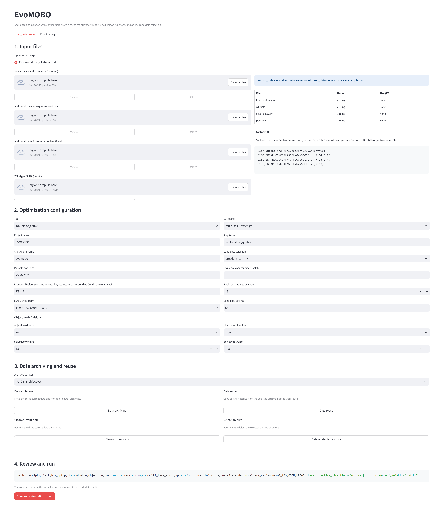

# EvoMOBO

## Abstract

We developed Evolution-inspired Multi-Objective Bayesian Optimization (EvoMOBO), an active-learning framework that integrates path-dependent candidate generation from elite parent sequences, acquisition-guided latent-space optimization, competitive selection across repeated searches, and explicit multi-objective optimization. By combining active learning with batch multi-objective Bayesian optimization, EvoMOBO enables efficient protein sequence optimization under limited experimental or computational evaluation budgets. The framework supports interchangeable protein language model (PLM), mCNN, and one-hot sequence encoders, together with multiple surrogate models, acquisition functions, and final-selection strategies. The search space can be restricted to user-defined mutable sites, allowing optimization to focus on mechanistically or experimentally relevant sequence regions. EvoMOBO accepts either experimental measurements or mechanistically relevant computational descriptors as objective values, enabling lower-cost computational evaluations to guide optimization when experimental data are limited. At each iteration, an acquisition function guides multiple independent latent-space optimization runs initiated from elite parent sequences. The resulting candidate batches are pooled and filtered, and the highest-ranked candidates are competitively selected from the complete candidate pool for the next round of experimental or computational evaluation. We benchmarked EvoMOBO on experimentally measured sequence-function landscapes. In a four-site combinatorial landscape of a DNA-binding domain (DBD), EvoMOBO shifted the relative response-element preference from the estrogen response element (ERE) toward the steroid response element (SRE). In a three-site combinatorial landscape of the ParD3 antitoxin, EvoMOBO shifted interaction specificity from ParE3 toward ParE2. We further evaluated EvoMOBO in a three-objective ParD3 task combining fitness measurements against ParE2, ParE3, and the V5L/A66F variant of ParE3, where it advanced the three-objective Pareto front and enriched variants satisfying all three target criteria. Finally, we applied EvoMOBO to two practical enzyme-engineering tasks, improving the non-native oxidative dehydrogenation activity of GkOYE and the colloidal stability of AoFOx.

## Installation

### Environment

The recommended software environment is:

```text
Linux architecture: x86_64
Rocky Linux version: 9.7
CUDA version: 12.8
Python version: 3.10
```

The main hardware configuration used for model development was:

```text
GPU: NVIDIA RTX PRO 6000 Blackwell
CPU: AMD Ryzen 9 9950X
```

Clone this repository locally and deploy the model together with the required packages in a Python 3.10 environment created using Anaconda.

```bash
git clone https://github.com/Kaiwen1973/EvoMOBO.git
cd EvoMOBO
```

### ESM-2, mCNN, and one-hot environment

Use this environment with `encoder=esm`, `encoder=mcnn`, or `encoder=onehot`.

```bash
conda create -n EvoMOBO -y -c conda-forge python=3.10 pip=24.3.1 setuptools=69.5.1 wheel git
conda activate EvoMOBO

python -m pip install setuptools-scm==6.4.2
python -m pip install torch==2.8.0+cu128 torchvision==0.23.0+cu128 --index-url https://download.pytorch.org/whl/cu128
python -m pip install --no-build-isolation -r requirements.txt
python -m pip install -e .
python -m pip check
```

### ESM-C environment

Use this environment with `encoder=esmc`.

```bash
conda create -n EvoMOBO-esmc -y -c conda-forge python=3.10 pip=24.3.1 setuptools=69.5.1 wheel git
conda activate EvoMOBO-esmc

python -m pip install setuptools-scm==6.4.2
python -m pip install torch==2.8.0+cu128 torchvision==0.23.0+cu128 --index-url https://download.pytorch.org/whl/cu128
python -m pip install --no-build-isolation -r requirements_esmc.txt
python -m pip install -e .
python -m pip check
```

### ProtBERT environment

Use this environment with `encoder=protbert`.

```bash
conda create -n EvoMOBO-protbert -y -c conda-forge python=3.10 pip=24.3.1 setuptools=69.5.1 wheel git
conda activate EvoMOBO-protbert

python -m pip install setuptools-scm==6.4.2
python -m pip install torch==2.8.0+cu128 torchvision==0.23.0+cu128 --index-url https://download.pytorch.org/whl/cu128
python -m pip install --no-build-isolation -r requirements_protbert.txt
python -m pip install -e .
python -m pip check
```

## Sequence optimization in a graphical interface

EvoMOBO provides a graphical interface for quickly launching multi-objective sequence optimization, including file uploading, workflow configuration, progress monitoring, and result downloads. Launch the interface from the Conda environment required by the selected encoder. Select the optimization stage, then upload `known_data.csv` and `wt.fasta` for the first round or a completed `exam.csv` for the second and subsequent rounds; `seed_data.csv` and `pool.csv` are optional. Configure the optimization workflow according to the specific task, then click `Run one optimization round` to start. Progress and outputs can be inspected under `Results & Logs`.



### Local server

```bash
python streamlit_app/launch.py --mode local
```

### Remote server

```bash
python streamlit_app/launch.py --mode remote  --public-host your_server_ip  --port your_tcp_port
```

## Sequence optimization in terminal

EvoMOBO can also launch optimization tasks directly from the terminal. Users can select or replace modules from the command line for a specific task. Advanced settings can be configured through the files in the `hydra_config` directory.

### Input

Before starting optimization, place required input files and any optional input files in in `./evomobo/assets/input_learning/`.

- `wt.fasta` contains the wild-type sequence.
- `known_data.csv` contains evaluated sequences used for surrogate training and non-dominated solution identification.
- `seed_data.csv` contains additional evaluated sequences used only for surrogate training.
- `pool.csv` contains additional mutation-source sequences sampled according to their sampling weights.

Objective columns must be named consecutively as `objective0`, `objective1`, ..., `objectiveN-1`. A two-objective input file has the following format:

```csv
Name,mutant_sequence,objective0,objective1
E25G,SKPKRLCQVCGDHASGFHYGVWSCGGC...,7.14,9.15
E25L,SKPKRLCQVCGDHASGFHYGVWSCLGC...,7.23,8.49
E25C,SKPKRLCQVCGDHASGFHYGVWSCCGC...,7.43,8.08
...
```

For single-objective optimization, include only `objective0`. For optimization with three or more objectives, append `objective2`, `objective3`, and subsequent columns as required.

### Running

All optimization modes use `scripts/black_box_opt.py`. The examples below use ESM-2 650M and restrict mutations to user-defined residue positions.

#### Double-objective optimization

```bash
python scripts/black_box_opt.py \
 task=double_objective_task \
 encoder=esm \
 encoder.model.esm_variant=esm2_t33_650M_UR50D \
 surrogate=multi_task_exact_gp \
 acquisition=exploitative_qnehvi \
 optimizer.offline_selection_mode=greedy_mean_hvi \
 'task.objective_directions=[min,max]' \
 'optimizer.mutable_positions="25,26,28,29"'
```

#### Multi-objective optimization

For optimization with three or more objectives, the number of entries in `task.objective_directions` must match the number of consecutive objective columns in the input files. Each entry must be either `min` or `max`.

```bash
python scripts/black_box_opt.py \
 task=multi_objective_task \
 encoder=esm \
 encoder.model.esm_variant=esm2_t33_650M_UR50D \
 surrogate=multi_task_exact_gp \
 acquisition=exploitative_qnehvi \
 optimizer.offline_selection_mode=greedy_mean_hvi \
 'task.objective_directions=[min,max,min]' \
 'optimizer.mutable_positions="61,64,80"'
```

#### Single-objective optimization

```bash
python scripts/black_box_opt.py \
 task=single_objective_task \
 encoder=esm \
 encoder.model.esm_variant=esm2_t33_650M_UR50D \
 optimizer.offline_selection_mode=greedy_mean_ei \
 task.objective_direction=max \
 'optimizer.mutable_positions="25,26,28,29"'
```

### Module swapping

#### Encoders

The encoder can be selected using one of the following overrides. When using ESM-2, ESM-C, or ProtBERT, make sure to activate the corresponding Conda environment.

```bash
encoder=onehot
encoder=mcnn
encoder=esm encoder.model.esm_variant=esm2_t33_650M_UR50D
encoder=esmc encoder.model.model_name=esmc_600m
encoder=protbert encoder.model.model_name=Rostlab/prot_bert_bfd
```

#### Surrogate models

The available multi-objective surrogate overrides are:

```bash
surrogate=multi_task_exact_gp
surrogate=multi_task_gaussian_mlp
surrogate=multi_task_ibnn
surrogate=multi_task_vbll
```

The single-objective task uses:

```bash
surrogate=single_task_exact_gp
```

#### Acquisition functions

The available multi-objective acquisition overrides are:

```bash
acquisition=exploitative_qnehvi
acquisition=qnehvi
acquisition=qnparego
acquisition=qehvi
acquisition=qucb
```

The single-objective task uses:

```bash
acquisition=single_objective_ei
```

#### Candidate selection strategies

The available multi-objective candidate selection strategies are:

```bash
optimizer.offline_selection_mode=greedy_mean_hvi
optimizer.offline_selection_mode=rank1_batch_only
optimizer.offline_selection_mode=ranked_batch
```

The single-objective candidate selection strategies are:

```bash
optimizer.offline_selection_mode=greedy_mean_ei
optimizer.offline_selection_mode=rank1_batch_only
optimizer.offline_selection_mode=batch_ei
```

### Output

Output files generated after round `N` are stored in `./evomobo/assets/active_learning/roundN/`. The file `to_eval.csv` contains the sequences recommended for evaluation, and `exam_template.csv` provides the template for recording their measured objective values.

### Iteration

For the second round and subsequent rounds, manually enter the evaluated sequences and their measured objective values into `exam.csv`, and then run the same optimization command.


